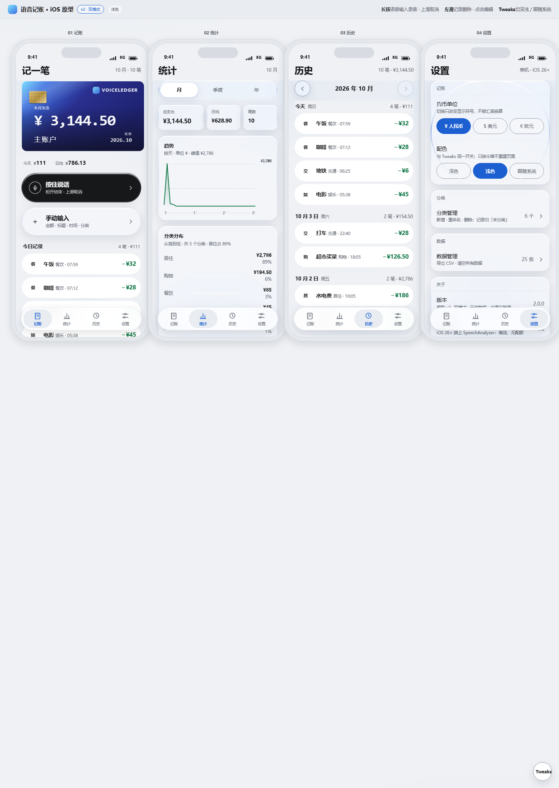
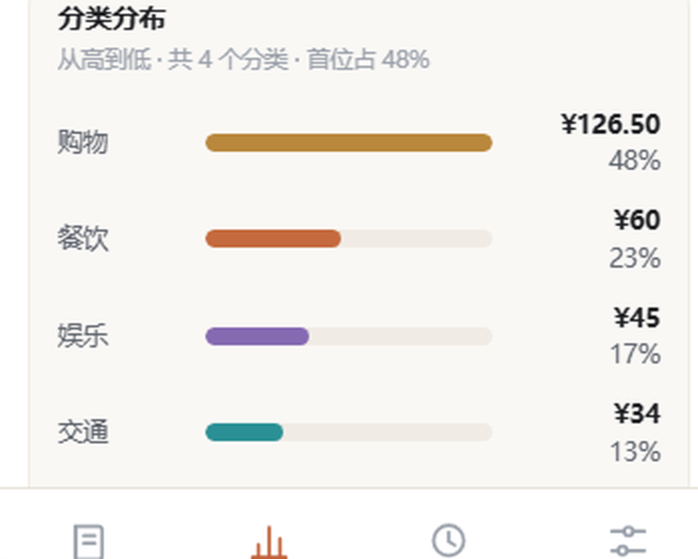
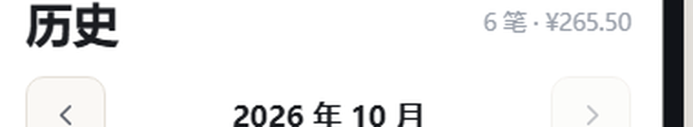

# 语音记账 · 说一句话，账就记完了

> 状态：原型与设计已定稿，iOS 原生工程待启动 ｜ 平台：iOS 26+ ｜ 协议：[MIT](LICENSE) ｜ 仓库：https://github.com/OneStar1107/voice-ledger

记账 App 的通病：**记一笔太重**——打开、选分类、输金额、保存，三步走完就懒得动了。

这个产品的赌注很简单：**说话是最快的输入**。
“午饭花了三十五块”——说完，金额已经在确认卡里，点一下，账就记完了。

## 先看为快

原型 v2 已完成深/浅双模式，浏览器直接打开：

```bash
git clone https://github.com/OneStar1107/voice-ledger.git
# 然后双击打开
prototype/记账App原型-v2.html
```

| 语音 / 手动同一张表单 | 浅色主界面 |
|---|---|
|  |  |

| 统计 · 分类分布 | 历史 · 月份导航 |
|---|---|
|  |  |

深色全览、v1 冻结版全览、趋势图细节与图标候选在 [`docs/screenshots/`](docs/screenshots/)。

## 功能特性（原型已实现）

- **语音记一笔**：说一句话 → 金额自动提取 → 预填确认卡 → 改完即存。ASR 不准时，人能兜底
- **手动记账**：与语音复用同一张表单，两个入口不分家
- **四个 Tab**：记一笔 / 统计 / 历史 / 设置
- **深浅双模式**：8 张卡面纯 CSS 零位图，字区对比度实测 7.44–11.93:1
- **数据自主**：导出 CSV、一键清空，全部本地完成
- **视觉规范**：冰川蓝品牌色；收入 = 红，支出 = 绿（国内习惯）；危险 = 琥珀

## 设计思路（这个项目的真正主角）

**核心赌注：语音优先 + 确认卡兜底。**
全自动记账的错误代价是“账错了”，所以把最后一步交还给人——这是“快”与“准”之间的取舍：机器负责快，人负责准。

**v1 的克制**：只做支出、金额恒正。先把一个闭环打穿，再谈扩展。

**设计系统**：M3 提示词包定稿双模式；8 张卡面全部纯 CSS 实现（零位图）——原型阶段位图修改成本太高，CSS 令牌才能让深浅模式共享同一套逻辑。

**质量门禁**：原型不是“看起来像”，是“量过像”——

- smoke 测试 100/100
- 玻璃态对比度 12 组全达标
- 静态审计 0 WARN
- 文字区对比度实测 7.44–11.93:1

工具链在 [`tools/`](tools/)：`cd tools && npm install` 后可复跑全部检查。

## 技术栈

| 层 | 现状 |
|---|---|
| 原型（已实现） | HTML + CSS + JS，零依赖，双击即跑 |
| App（规划中） | SwiftUI + SwiftData + Swift Charts + SpeechAnalyzer（iOS 26+），无三方 SDK 硬依赖 |
| 数据 | SwiftData 设备本地存储——无账号、无后端，你的账只在你手机上 |

## 快速开始

```bash
git clone https://github.com/OneStar1107/voice-ledger.git
# 原型 v2（推荐，双模式）
prototype/记账App原型-v2.html
# 原型 v1 为历史冻结版，仅存档
prototype/记账App原型-v1.html
```

## 项目结构

```text
voice-ledger/
├── prototype/                          # HTML 原型（v2 当前版 / v1 冻结版）
├── M3/                                 # 视觉规范：提示词包 v3、卡面、图标候选
├── design-system/                      # 设计系统（_build.mjs 待修复，见 PRD R-001）
├── tools/                              # 验证工具链：六套检查脚本 + PIL 小工具
├── docs/screenshots/                   # 截图（README 与验收用）
├── PRD.md                              # 需求与改动登记处
├── AGENTS.md                           # 开发协作规则（AI 宪法）
├── TODO.md                             # 想法停车场
├── DEV.md                              # 开发状态备忘（协作者向）
├── 设计方案与验收记录-v1.md             # 设计依据（只读）
├── LICENSE                             # MIT
└── README.md
```

## 路线图

- [x] 原型 v2 双模式，六套检查全部通过
- [x] 开源发布：https://github.com/OneStar1107/voice-ledger
- [ ] App 图标定稿（3 选 1，麦克风胶囊暂居推荐位）
- [ ] iOS 原生工程立项：SwiftUI 骨架 + 数据模型 + 手动记账闭环
- [ ] 语音链路：SpeechAnalyzer → 金额提取 → 确认卡
- [ ] 真机核验（ASR 金额提取 ≥90% 等 7 项）

## 写给开发协作者

本仓库的日常协作规则见 [AGENTS.md](AGENTS.md)；需求与改动登记在 [PRD.md](PRD.md)；想法停车场在 [TODO.md](TODO.md)；开发状态备忘见 [DEV.md](DEV.md)。

## License

[MIT](LICENSE) —— 随便看、随便改、保留署名即可。
